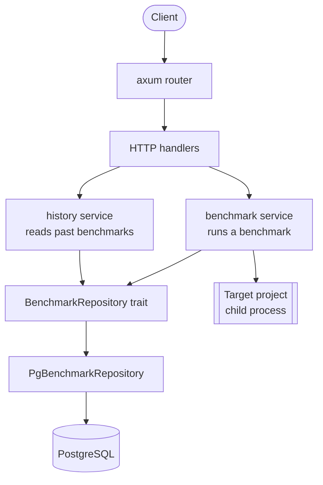
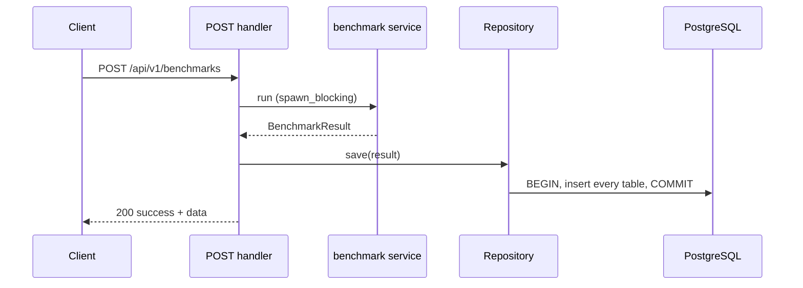
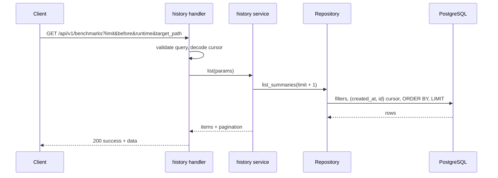
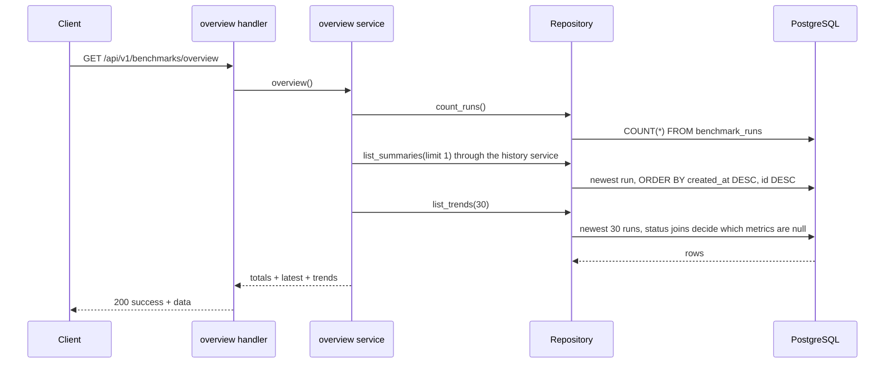
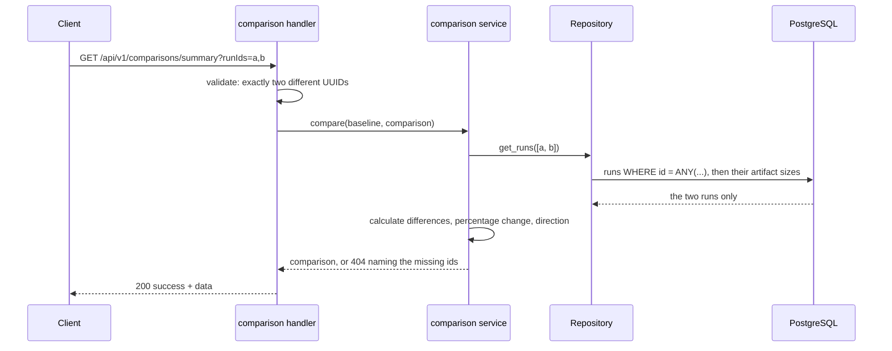

# Architecture

## Overview

The API has three layers. HTTP handlers know nothing about SQL, the benchmark domain knows nothing about the database driver, and PostgreSQL is only reached through one repository trait.



## Modules

```text
src/
├── main.rs                 startup: env, database, migrations, server
├── app.rs                  router assembly (shared by main and API tests)
├── app_state.rs            Env + Arc<dyn BenchmarkRepository>
├── config/                 Env and DatabaseConfig loading
├── schemas/                validated environment shapes
├── errors/                 global response shapes and error catalogue
├── features/v1/benchmark/
│   ├── handler.rs          POST route, route table
│   ├── service.rs          one benchmark run, start to result
│   ├── discovery.rs        runtime detection
│   ├── metrics/            artifact size, build, startup, memory, CPU, HTTP latency
│   ├── workload/           HTTP load plan, executor, observations
│   ├── target_process.rs   start and stop the target process group
│   ├── history/            GET list and GET detail (handler, service, query, cursor, model)
│   └── model.rs            BenchmarkResult, the shape POST returns and GET detail rebuilds
├── features/v1/overview/
│   ├── handler.rs          GET /benchmarks/overview
│   ├── service.rs          count, latest through the history service, trend points
│   ├── convert.rs          trend row to API point, no calculation
│   ├── error.rs            storage failures
│   └── model.rs            the overview response
├── features/v1/comparison/
│   ├── handler.rs          GET /comparisons/summary
│   ├── query.rs            strict runIds parsing
│   ├── service.rs          loads the two runs, reports missing ones
│   ├── compare.rs          pure calculation, two runs in, one comparison out
│   ├── metric.rs           difference, percentage change, direction
│   └── model.rs            the comparison response
└── persistence/
    ├── repository.rs       BenchmarkRepository trait
    ├── history.rs          storage-side types of the history list
    ├── stored_run.rs       one rebuilt run plus its created_at
    ├── error.rs            PersistenceError
    └── postgres/           sqlx implementation
        ├── insert.rs       write one run in one transaction
        ├── mapping.rs      BenchmarkResult to rows
        ├── summary.rs      list SQL
        ├── overview.rs     run count and trend SQL, comparison rules in the query
        ├── detail.rs       detail SQL, one run or several in two queries
        └── reconstruct.rs  rows back to BenchmarkResult
```

## Persistence boundary

```text
BenchmarkRepository
├── save(result)                  one transaction, all tables or none
├── list_summaries(query)         filters, cursor and limit applied in SQL
├── get_by_run_id(run_id)         rebuilds the POST result, None when absent
├── get_runs(run_ids)             rebuilds exactly the requested runs, absent ids are missing
├── count_runs()                  the number of every stored run
└── list_trends(limit)            newest runs, comparison rules applied in SQL, newest first
```

- API tests use an in-memory fake of the trait, so they need no database.
- Repository tests run against real PostgreSQL when `TEST_DATABASE_URL` is set.
- The normalized tables are the only source of truth. There are no summary or history tables and no caching.

## Write path



If storing fails the endpoint returns `500` and nothing is stored.

## Read path



The service asks for one row more than `limit`. The extra row only answers "is there another page" and is never returned.

## Overview path



The overview is derived and read-only. It adds no table, view, cache or job. The trend query joins `benchmark_statuses` for the build, the startup and the HTTP result, so a build or startup duration is only returned for a `success` status and the HTTP numbers only for a `completed` workload with at least one request. `latest` reuses the history summary and keeps its raw values, which is why it can differ from the first trend point of the same run.

## Comparison path



A comparison is derived and read-only. It adds no table, stores nothing and loads no unrelated run.

## Response shapes

```json
{ "success": true, "httpCode": 200, "message": "...", "data": {} }
```

```json
{ "success": false, "httpCode": 400, "code": "VALIDATION_ERROR", "message": "...", "error": "..." }
```

| Code | HTTP | Used for |
| --- | --- | --- |
| `BAD_REQUEST` | 400 | malformed JSON, bad path, malformed `run_id` |
| `VALIDATION_ERROR` | 400 | invalid body fields, bad query parameters, bad cursor |
| `NOT_FOUND` | 404 | unknown route, unknown run |
| `METHOD_NOT_ALLOWED` | 405 | wrong method on an existing route |
| `INTERNAL_SERVER_ERROR` | 500 | benchmark failure after validation, storage failure |
