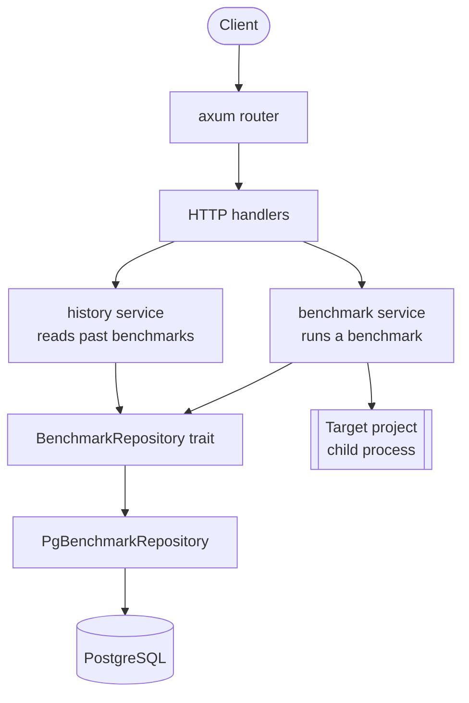
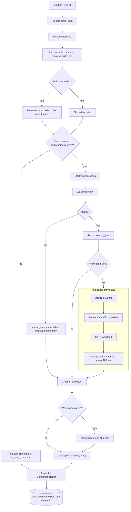
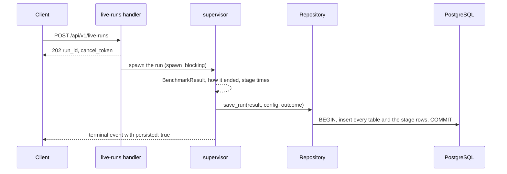
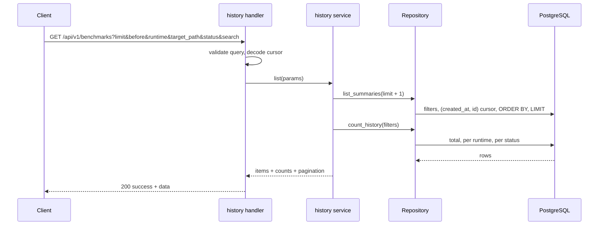
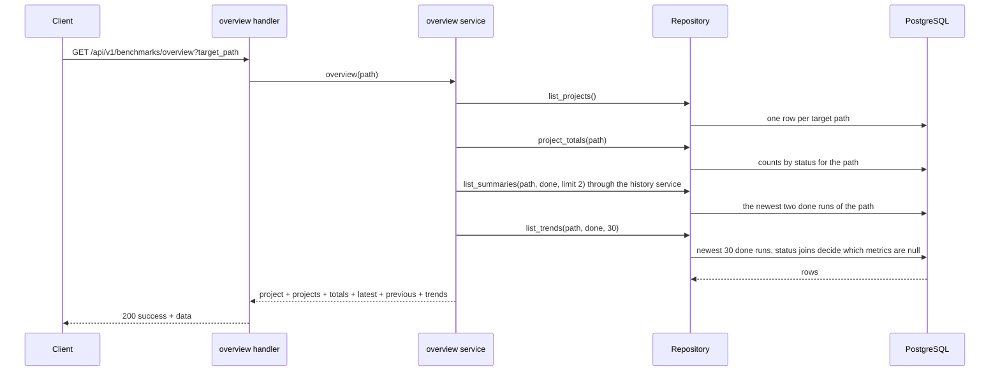
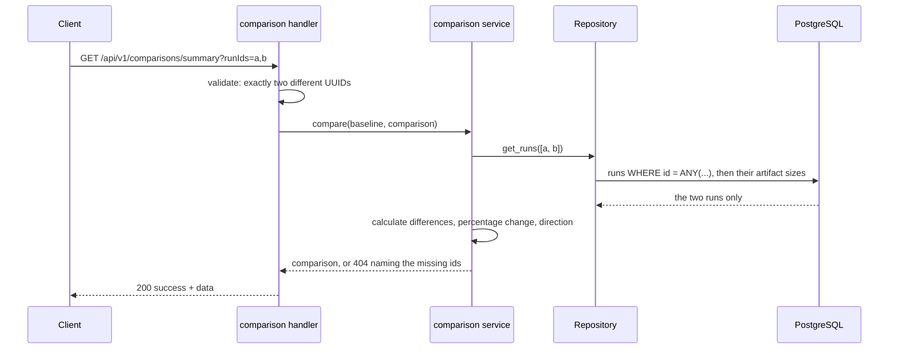

# Architecture

## Overview

The API has three layers. HTTP handlers know nothing about SQL, the benchmark domain knows nothing about the database driver, and PostgreSQL is only reached through one repository trait.



## Modules

```text
src/
├── main.rs                 startup: env, database, migrations, server
├── app.rs                  router assembly (shared by main and API tests)
├── app_state.rs            Env + Arc<dyn BenchmarkRepository>
├── request_id.rs           the x-request-id middleware, one short id per request
├── origin.rs               the allowed browser origins, shared by CORS and the WebSocket check
├── config/                 Env and DatabaseConfig loading
├── schemas/                validated environment shapes
├── errors/                 global response shapes and error catalogue
├── features/v1/benchmark/
│   ├── handler.rs          route table (GET only, a run is started with POST /live-runs)
│   ├── service.rs          one benchmark run, start to result
│   ├── discovery.rs        runtime detection
│   ├── cleanup.rs          the cleanup commands that run last (build and Docker)
│   ├── workspace/          extra processes measured natively and in Docker
│   ├── metrics/            artifact size, build, startup, memory, CPU, HTTP latency
│   ├── workload/           HTTP load plan, executor, observations
│   ├── target_process.rs   start and stop the target process group
│   ├── history/            list, detail, delete and stage averages (handler, service, query, cursor, model, stage_averages)
│   ├── live/               live runs: slot, registry, event log, supervisor, WebSocket, cancel, active run
│   └── model.rs            BenchmarkResult, the shape a finished run has and GET detail rebuilds
├── features/v1/overview/
│   ├── handler.rs          GET /benchmarks/overview?target_path=
│   ├── service.rs          one project: totals, latest two done runs, trend points
│   ├── convert.rs          trend row to API point, no calculation
│   ├── error.rs            validation and storage failures
│   └── model.rs            the overview response
├── features/v1/targets/    saved targets: file, catalog, resolve, view, handler
├── features/v1/status/     GET /status/ws, the dashboard socket (active run, health, ping)
├── features/v1/health/
│   └── handler.rs          GET /health, pings the database
├── features/v1/comparison/
│   ├── handler.rs          GET /comparisons/summary
│   ├── query.rs            strict runIds parsing
│   ├── service.rs          loads the two runs, reports missing ones
│   ├── compare.rs          pure calculation, two runs in, one comparison out
│   ├── metric.rs           difference, percentage change, direction
│   └── model.rs            the comparison response
└── persistence/
    ├── repository.rs       BenchmarkRepository trait
    ├── history.rs          storage-side types of the history list
    ├── stored_run.rs       one rebuilt run plus its created_at
    ├── error.rs            PersistenceError
    └── postgres/           sqlx implementation
        ├── insert.rs       write one run in one transaction
        ├── mapping.rs      BenchmarkResult to rows
        ├── summary.rs      list and counts SQL
        ├── removal.rs      soft delete
        ├── stage_runs.rs   stage rows of the newest done runs, database ping
        ├── overview.rs     project list, totals and trend SQL, comparison rules in the query
        ├── detail.rs       detail SQL, one run or several in two queries
        └── reconstruct.rs  rows back to BenchmarkResult
```

## Benchmark lifecycle

A benchmark owns the target process from start to shutdown. Every measurement happens while the same process stays alive.



### Workspaces

Workspaces are optional. They run after the main project has finished and shut down, one workspace at a time, native first and Docker second, never together.

1. Pre-check, before anything starts: when a copy of a workspace is already running the whole run is refused with `409 CONFLICT` and says what to stop.
2. Prepare the environment: read the env file or parse the pasted text into a variable map.
3. Native, if enabled: run the optional build command, start the command with that environment, wait for the ready log line, stabilize, read the baseline, then run the load command or idle for `idle_seconds` while RSS and CPU are sampled every 100 ms, then stop the process group.
4. Docker, if enabled: run the build command (own timeout) and record its time, read the image size, write the variables to a temporary owner-only file, run the container, wait for the ready line in its logs, find the container's main process and measure it and its children from `/proc`, the same way the native process is measured. Remove the container and delete the temporary file.

Everything a workspace started is stopped before the next step, also after a failure or a cancel. A mode that fails to build, start or become ready records `failed` or `timeout` with `null` numbers, and the other mode still runs.

### Cleanup

The cleanup commands (`cleanup` and each Docker workspace's `docker.cleanup`) run last, whatever the outcome, build first and then Docker. A failed cleanup is shown on its own step and never changes the status of the run. See [api.md](api.md#cleanup-optional).

### Rules

- Nothing is inferred. The build command is given by the caller and never detected. Start command, readiness check and workload are only used when the request provides them.
- `memory`, `cpu` and `http_latency` are `null` when no workload ran or startup did not succeed. Nothing is fabricated.
- If the target dies during the workload, partial measurements are kept and `http_latency.status` is `target_exited`.
- A workload is either a fixed `requests` count or a sustained `duration_seconds`, never both.
- The target is always shut down, including after failures.

### Result

```text
data
├── run_id
├── target
├── discovery
└── metrics
    ├── artifact_size
    ├── build_time
    ├── startup_time
    ├── memory
    ├── cpu
    ├── http_latency
    └── workspaces        (only when the run had workspaces)
```

`run_id` is a UUIDv7. Its embedded timestamp is the stored `created_at` of the run.

### Stored statuses

`success`, `failed`, `timeout`, `unhealthy`, `no_start_command`, `no_port`, `completed`, `target_exited`. Runs stored before the build command became required can also hold `no_build_command`.

## Persistence boundary

```text
BenchmarkRepository
├── save_run(result, config, outcome)  one transaction, all tables or none, for a done, failed or cancelled run
├── list_summaries(query)         filters, cursor and limit applied in SQL
├── count_history(query)          the counts of the filter pills
├── get_by_run_id(run_id)         rebuilds the result of a run, None when absent or deleted
├── get_runs(run_ids)             rebuilds exactly the requested runs, absent ids are missing
├── delete_run(run_id)            soft delete, every read stops seeing the run
├── list_projects()               one entry per target path with its run counts
├── project_totals(path)          how the runs of one path ended
├── list_trends(query)            newest runs of a path and status, comparison rules applied in SQL
├── recent_stage_runs(path, n)    the stages of the newest done runs of a path
└── ping()                        whether the database answers

Every read filters `deleted_at IS NULL`.
```

- API tests use an in-memory fake of the trait, so they need no database.
- Repository tests run against real PostgreSQL when `TEST_DATABASE_URL` is set.
- The normalized tables are the only source of truth. There are no summary or history tables and no caching.

## Write path



A run is stored however it ends: done, failed or cancelled, with every part that finished and its stage times. If storing fails nothing is stored and the terminal event says `persisted: false`.

## Read path



The service asks for one row more than `limit`. The extra row only answers "is there another page" and is never returned.

## Overview path



The overview is derived and read-only. It adds no table, view, cache or job. Every query behind it filters by the same path, so two projects never mix. Without a path the service takes the path of the newest done run, or of the newest run when none is done. The trend query joins `benchmark_statuses` for the build, the startup and the HTTP result, so a build or startup duration is only returned for a `success` status and the HTTP numbers only for a `completed` workload with at least one request. `latest` reuses the history summary and keeps its raw values, which is why it can differ from the first trend point of the same run.

## Stage averages path

`GET /benchmarks/stage-averages?target_path=` reads the stage rows of the newest 3 done runs of a path (`recent_stage_runs`) and the service averages them. Nothing is stored. A stage without a duration is skipped, never counted as zero.

## Comparison path



A comparison is derived and read-only. It adds no table, stores nothing and loads no unrelated run.

## Response shapes

```json
{ "success": true, "httpCode": 200, "message": "...", "data": {} }
```

```json
{ "success": false, "httpCode": 400, "code": "VALIDATION_ERROR", "message": "...", "error": "...", "requestId": "a3f09c1e" }
```

`requestId` is the id the `request_id` middleware gave the request, the same value as the `x-request-id` response header. The middleware wraps every route and the fallback, and the id travels with the request in a task local, so `ApiError` can put it in the body without the handlers knowing.

| Code | HTTP | Used for |
| --- | --- | --- |
| `BAD_REQUEST` | 400 | malformed JSON, bad path, malformed `run_id` |
| `VALIDATION_ERROR` | 400 | invalid body fields, bad query parameters, bad cursor |
| `FORBIDDEN` | 403 | refused origin, raw run while custom runs are off, wrong cancel token |
| `NOT_FOUND` | 404 | unknown route, unknown or deleted run |
| `METHOD_NOT_ALLOWED` | 405 | wrong method on an existing route |
| `CONFLICT` | 409 | another benchmark is running |
| `INTERNAL_SERVER_ERROR` | 500 | benchmark failure after validation, storage failure |
| `SERVICE_UNAVAILABLE` | 503 | `/health` when the database cannot be reached |
