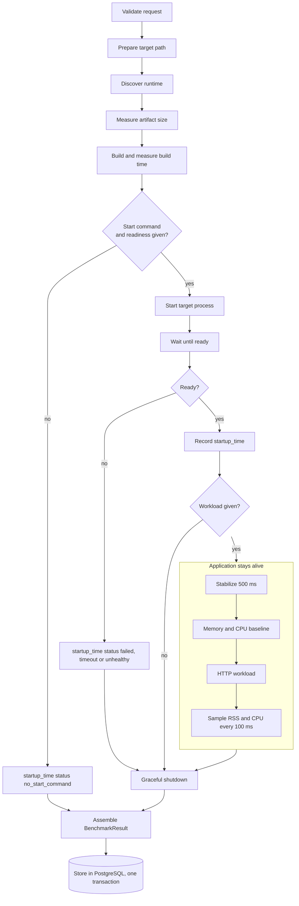

# Benchmark lifecycle

## Steps

A benchmark owns the target process from start to shutdown. Every measurement happens while the same process stays alive.



## Rules

- Nothing is inferred. Start command, readiness check and workload are only used when the request provides them.
- `memory`, `cpu` and `http_latency` are `null` when no workload ran or startup did not succeed. Nothing is fabricated.
- If the target dies during the workload, partial measurements are kept and `http_latency.status` is `target_exited`.
- A workload is either a fixed `requests` count or a sustained `duration_seconds`, never both.
- The target is always shut down, including after failures.

## Result

```text
data
├── run_id
├── target
├── discovery
└── metrics
    ├── artifact_size
    ├── build_time
    ├── startup_time
    ├── memory
    ├── cpu
    └── http_latency
```

`run_id` is a UUIDv7. Its embedded timestamp is the stored `created_at` of the run.

## Stored statuses

`success`, `failed`, `timeout`, `unhealthy`, `no_build_command`, `no_start_command`, `no_port`, `completed`, `target_exited`.
